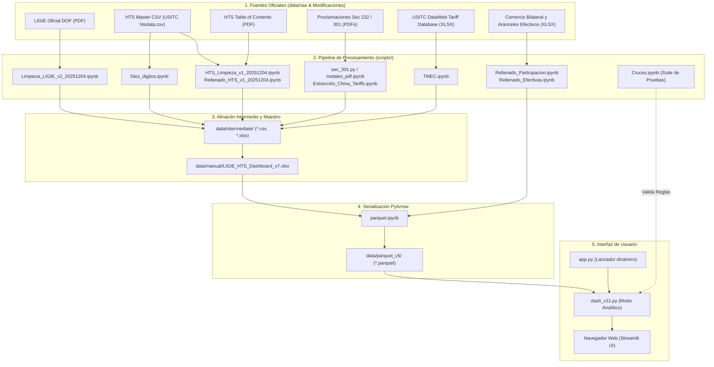

# Monitor de Comercio y Aranceles | NAFIN - BANCOMEXT
## Documentación Técnica, Funcional y Manual de Traspaso Operativo

> **Documento de Entrega y Continuidad Operativa**  
> **Área:** Análisis Económico y Comercio Exterior / Dirección de Estudios Financieros  
> **Institución:** Banco Nacional de Comercio Exterior (BANCOMEXT) / Nacional Financiera (NAFIN)  
> **Versión del Tablero Documentada:** `dash_v11.py` (desplegado vía `app.py`)  
> **Versión de Datos Operativa:** `data/parquet_v5/`  
> **Fecha de Documentación:** Octubre 2026  

---

## 1. Resumen Ejecutivo y Propósito Estratégico

El **Monitor de Comercio y Aranceles** es una plataforma analítica interactiva de alto rendimiento desarrollada en Python y Streamlit para BANCOMEXT y NAFIN. Su objetivo primordial es brindar inteligencia comercial y técnica inmediata sobre el impacto de las políticas arancelarias proteccionistas aplicadas por los Estados Unidos de América sobre las exportaciones mexicanas, en contraste directo con su principal competidor global, la República Popular China, así como otros socios comerciales relevantes (Canadá, Vietnam y Taiwán).

El sistema permite:
1. **Analizar la estructura arancelaria mexicana (LIGIE)** a nivel de fracción (8 dígitos), conociendo el arancel general de importación e identificando mercancías de importación prohibida.
2. **Desglosar la estructura arancelaria estadounidense (HTS / HTSUS)** a nivel de fracción (8 y 10 dígitos), evaluando la tasa general (Columna 1 General) descompuesta en sus componentes matemáticos ad-valorem y tarifas fijas/específicas.
3. **Simular con rigor legal y matemático las medidas arancelarias extraordinarias de EE. UU.**, incluyendo:
   - **Sección 232 del Trade Expansion Act of 1962:** Metales (Acero, Aluminio, Cobre y sus derivados), Automóviles y autopartes, Vehículos de Carga Mediana y Pesada (MHDV) y Autobuses, Madera y sus manufacturas (gabinetes/tocadores), Semiconductores y su maquinaria, y Artículos Farmacéuticos (Pharma).
   - **Sección 301 del Trade Act of 1974 (China Tariffs):** Sobretasas históricas por prácticas comerciales desleales aplicables exclusivamente a China.
   - **Sección 301 del Trade Act of 1974 (Trabajo Forzoso / FLIP 301):** Medida acumulativa sobre 60 economías que impone aranceles del 10% a México (exento bajo T-MEC) y 12.5% a China, con reglas de alcance (*scope*).
   - **Tratado México-Estados Unidos-Canadá (T-MEC / USMCA):** Esquemas preferenciales de desgravación, reglas de origen y beneficios arancelarios por Valor de Contenido Regional (RVC).
4. **Resolver ambigüedades arancelarias en tiempo real** mediante un *Wizard* interactivo que guía al analista a través de cuestionarios condicionantes basados en los textos de las proclamaciones oficiales.
5. **Evaluar el desempeño histórico de mercado (2018-presente)** mediante indicadores clave de competitividad (volumen de importación en USD, cuota de mercado en las importaciones de EE. UU. y arancel efectivo ponderado) y visualizaciones dinámicas de series temporales.

---

## 2. Arquitectura del Sistema y Flujo de Datos

El flujo integral de datos sigue una arquitectura desacoplada en tres capas: **Adquisición y Extracción (Raw)**, **Estructuración y Enriquecimiento (Intermediate/Manual)**, y **Consumo Optimizado en Memoria (Parquet v5 / Streamlit)**.



---

## 3. Guía de Ejecución y Despliegue

### 3.1. Requisitos de Entorno
- **Sistema Operativo:** Windows 10/11, macOS o Linux.
- **Python:** 3.10 o superior (recomendado 3.11).
- **Dependencias Principales:**
  ```bash
  pip install streamlit pandas numpy altair pyarrow openpyxl xlsxwriter pdfplumber
  ```

### 3.2. Lanzador Oficial (`app.py`)
El archivo [`app.py`](app.py) funge como punto de entrada de la aplicación. Su diseño permite cambiar de versión sin alterar los accesos directos ni el comando de arranque del servidor.

```python
import streamlit as st

VERSION_ACTUAL = "dash_v11.py"  # Modificar únicamente esta variable si se crea una nueva versión

try:
    with open(VERSION_ACTUAL, "r", encoding="utf-8") as file:
        codigo = file.read()
        exec(codigo, globals())
except FileNotFoundError:
    st.error(f"🚨 No se encontró el archivo: `{VERSION_ACTUAL}`")
except Exception as e:
    st.error(f"🚨 Ocurrió un error al ejecutar `{VERSION_ACTUAL}`:")
    st.exception(e)
```

### 3.3. Comando de Arranque
Para ejecutar el tablero localmente, abrir la terminal de PowerShell en el directorio raíz del proyecto y ejecutar:
```powershell
streamlit run app.py
```
Por defecto, la interfaz estará disponible en el navegador web en `http://localhost:8501`.

---

## 4. Documentación Detallada de `dash_v11.py`

[`dash_v11.py`](dash_v11.py) (2,827 líneas) es el núcleo analítico de la plataforma. A continuación se desglosa su arquitectura técnica, lógicas de negocio, fórmulas y componentes visuales.

### 4.1. Configuración, CSS Institucional y Branding
- **Configuración de Página:** Se establece modo panorámico (`layout="wide"`), icono temático `📊` y título oficial `"Dashboard Arancelario | NAFIN - BANCOMEXT"`.
- **Renderizado de Banderas:** Utiliza la tipografía Google Font `Noto Color Emoji` mediante inyección de CSS para garantizar que los emojis de banderas (🇲🇽, 🇺🇸, 🇨🇳, 🇨🇦, 🇻🇳, 🇹🇼) se rendericen nítidamente en Windows sin degradarse a cajas de texto o símbolos monocromáticos.
- **Paleta Institucional NAFIN/Bancomext:**
  - Azul Corporativo: `#2596be`
  - Verde Esmeralda / Medidas Especiales: `#008889`
  - Verde T-MEC Preferencial: `#166534` (fondo `#dcfce7`)
  - Azul RVC: `#0369a1` (fondo `#e0f2fe`)
  - Slate Neutro / Títulos: `#0F172A` y `#64748B`
  - Fondo de Aplicación: `#F8FAFC`
- **Diseño de Tablas (`.tabla-aranceles`):** Tablas CSS ultra-compactas con encabezados sticky, alineación tipográfica uniforme y bordes suaves de separación.

### 4.2. Carga y Caché de Datos (`load_data`)
La función `load_data(target_country="China")` está decorada con `@st.cache_data(show_spinner="...")`, lo que permite cargar en memoria los 15 datasets en formato Parquet desde `data/parquet_v5/` de forma instantánea tras la primera ejecución:

| Dataset Parquet | Registros / Función | Columnas Clave |
| :--- | :--- | :--- |
| `ligie.parquet` | Catálogo arancelario de México (8 dígitos) | `Código`, `Sección`, `Capítulo`, `Partida`, `Subpartida`, `Desdoblamiento`, `Fracción`, `General` |
| `hts.parquet` | Catálogo arancelario de EE. UU. (8 dígitos) | `Code`, `Section`, `Chapter`, `Heading`, `Breakdown`, `Subheading`, `Description`, `General` |
| `sec_301.parquet` | Sobretasas históricas Sección 301 China | `Code`, `Duty`, `Description` |
| `metals.parquet` | Sección 232 Metales (Acero, Aluminio, Cobre) | `Code`, `Duty`, `Description` |
| `tmec.parquet` | Desgravaciones T-MEC / USMCA | `Code`, `Duty` |
| `rvc.parquet` | Fracciones elegibles para Valor de Contenido Regional | `Code`, `Duty` |
| `auxiliar.parquet` | Catálogo descriptivo a 10 dígitos HTS | `Code`, `Duty`, `Description` |
| `flip_301.parquet` | Sección 301 Trabajo Forzoso (FLIP 301) | `code`, `scope`, `description` |
| `pharma.parquet` | Sección 232 Productos Farmacéuticos | `Code`, `Annex` |
| `auto.parquet` | Sección 232 Automóviles y Autopartes | `Code`, `Duty`, `Category` |
| `mhdv.parquet` | Sección 232 Vehículos Pesados/Medianos y Autobuses | `Code`, `Duty`, `Category` |
| `wood.parquet` | Sección 232 Madera y Muebles Derivados | `Code`, `Duty`, `Category` |
| `semi.parquet` | Sección 232 Semiconductores y Derivados | `Code`, `Duty` |
| `participacion.parquet` | Series de tiempo de valor y cuota de mercado | `Subpartida`, `Date`, `Mexico`, `China`, `participacion_mexico`, `participacion_china`, etc. |
| `efectivos.parquet` | Series de tiempo de aranceles efectivos cobrados | `Subpartida`, `Date`, `Mexico`, `China`, `Canada`, `Vietnam`, `Taiwán` |

Todas las funciones de carga normalizan nombres de columnas con `normalize_cols()` y estandarizan códigos numéricos con `clean_numeric_code()` eliminando puntos y espacios en blanco.

### 4.3. Motor de Parseo de Aranceles HTS (`parse_hts_duties`)
Los aranceles en el HTSUS no son simples números; con frecuencia combinan tasas ad-valorem con aranceles específicos basados en unidades de medida física (ejemplo: `$1.035/kg + 8.5%` o `Free`). La función `parse_hts_duties(val)` descompone la cadena en una tupla de 3 elementos:
1. `general_math` (`float`): Porción numérica del porcentaje ad-valorem para cálculos aritméticos posteriores (ejemplo: `8.5`).
2. `general_str` (`str`): Representación textual del porcentaje o estado (ejemplo: `"8.5%"` o `"Free"`).
3. `fixed_str` (`str`): Porción del arancel específico o fijo no sumable directamente (ejemplo: `"$1.035/kg"`).

### 4.4. Navegación en el Sidebar: Búsqueda Simple vs Avanzada
El usuario dispone de dos pestañas sincronizadas vía `st.session_state`:
- **Búsqueda Simple (`tab_simple`):** Selectores en cascada (*Capítulo* -> *Partida* -> *Subpartida / Búsqueda Libre*).
  - Incorpora callbacks bidireccionales (`cb_cap`, `cb_par`, `cb_sub`): si el usuario selecciona una partida, se autocompleta el capítulo; si borra la partida, se resetea la subpartida.
  - Soporta botones **⬅️ Anterior** y **Siguiente ➡️** para hojear subpartidas secuencialmente.
  - Botón de acción **Limpiar Búsqueda** que restablece todos los filtros y la vista central.
- **Búsqueda Avanzada (`tab_avanzado`):** Entrada de texto directa para códigos de subpartida de 6 dígitos con validación estricta de longitud y botones de avance/retroceso numérico.

---

### 4.5. Lógica de Jerarquía Arancelaria Presidencial (Sección 232)

Un reto fundamental de las proclamaciones emitidas por la Casa Blanca bajo la Sección 232 es que diversas mercancías caen simultáneamente en múltiples listas sectoriales. Legalmente, **los aranceles de la Sección 232 no se acumulan entre sí**. En su lugar, rige un principio de especificidad y prelación presidencial estricto implementado en el sistema:

$$\text{Jerarquía de Prelación Sectorial 232:}$$
$$\mathbf{1.\; Semiconductores} \;\succ\; \mathbf{2.\; Automóviles / MHDV / Autobuses} \;\succ\; \mathbf{3.\; Metales (Acero/Aluminio/Cobre)} \;\succ\; \mathbf{4.\; Madera} \;\succ\; \mathbf{5.\; Pharma}$$

En el código de `dash_v11.py`, la variable de control `product_claimed_by` asegura que, en cuanto un producto es catalogado y confirmado en un nivel superior de la jerarquía, los niveles inferiores son automáticamente anulados y sus tarjetas en la interfaz son ocultadas.

---

### 4.6. El Motor Wizard Interactivo y sus Tareas de Decisión

Cuando el analista ingresa una subpartida de 6 dígitos, el tablero analiza todas las fracciones arancelarias de 8 y 10 dígitos asociadas. Si alguna fracción requiere validación o desambiguación, se construye la estructura `wizard_queue_dict` y se despliega un panel interactivo (`st.expander("⚠️ Clasificación Requerida...")`).

A continuación se detalla cada tarea del Wizard:

#### 1. Desambiguación a 10 Dígitos (`10_digit`)
Si una subpartida a 8 dígitos tiene fracciones hijas a 10 dígitos con tratamientos arancelarios divergentes en los anexos presidenciales (ejemplo: un hijo paga 25% y otro 0%), el Wizard presenta una lista de opciones con sus descripciones completas extraídas de `auxiliar.parquet` para que el usuario elija la mercancía exacta.

#### 2. Cumplimiento de Origen T-MEC General (`tmec_general_task`)
Pregunta al usuario si el producto satisface los requisitos y certificaciones de origen bajo las reglas del T-MEC.
- Si responde **"Sí"**, habilita el acceso a las tasas preferenciales T-MEC y desencadena evaluaciones de excepciones sectoriales.
- Si responde **"No"**, el producto queda sujeto a los aranceles de nación más favorecida (Columna 1 General).

#### 3. Sección 232: Semiconductores y Equipo de Manufactura (`semi_task`)
- **Pregunta técnica de rendimiento:** Evalúa si el producto cumple con umbrales de desempeño avanzado:
  - *Opción a:* TPP entre 14,000 y 17,500 con DRAM entre 4,500 y 5,000 GB/s.
  - *Opción b:* TPP entre 20,800 y 21,100 con DRAM entre 5,800 y 6,200 GB/s.
- **Pregunta de destino de uso:** Si cumple el rendimiento, evalúa si su uso final en EE. UU. califica como exención estratégica (Centros de datos, reemplazos/reparaciones, I+D, startups, aplicaciones civiles de consumo o sector público).
- **Resultado:** Si el uso está exento, arancel = 0%; si no está exento, arancel = 25%.

#### 4. Sección 232: Automóviles y Autopartes (`auto_task` / `tmec_auto_task`)
- **Validación descriptiva:** Pregunta si el artículo corresponde a vehículos de pasajeros (*passenger vehicles: sedanes, SUVs, minivans*) o a sus partes.
- **Antigüedad (Vehículos):** Si es vehículo de pasajeros y tiene 25 años o más desde su fabricación, queda **exento (0%)**. Si tiene menos de 25 años, paga **25%**.
- **Autopartes T-MEC:** Si el producto es una autoparte originaria bajo T-MEC, está **exenta (0%)**, a menos que consista en *automobile knock-down kits or parts compilations*, en cuyo caso paga el **25%**.

#### 5. Sección 232: Vehículos Pesados/Medianos (MHDV) y Autobuses (`mhdv_task` / `tmec_mhdv_task`)
- **Categorización:** Distingue entre *Medium- and heavy-duty vehicles* (arancel base 25%), *Buses or other vehicles* (arancel base 10%) y *Parts*.
- **Antigüedad:** Aplica la exención de 25 años o más para vehículos completos.
- **Partes T-MEC:** Mismo tratamiento que autopartes: exención T-MEC salvo que se trate de *knock-down kits*.

#### 6. Sección 232: Metales (Acero, Aluminio y Cobre) (`metals_task` / `user_metals_decisions`)
- **Regla del 15% (Productos fuera de Capítulos 72, 73, 74 y 76):** Si un artículo manufacturado contiene metales regulados pero se clasifica fuera de dichos capítulos (ejemplo: maquinaria del Capítulo 84 u 85), el arancel de la Sección 232 **solo aplica si el peso conjunto de acero, aluminio o cobre es igual o mayor al 15% del peso total del producto**. Si es menor al 15%, el arancel es 0%.
- **Regla de Fundición y Moldeado en EE. UU. (Umbral del 85%):**
  - Si el metal fue fundido y moldeado en EE. UU. en al menos un **85%**:
    - Anexos I-A y I-B: Pagan **10%**.
    - Anexo I-C y Anexo III: Pagan $\max(0,\; 10\% - \text{Tasa Base General})$.
  - Si no cumple el umbral del 85%:
    - **Anexo I-A (Materias primas y principales):** Paga **50%**.
    - **Anexo I-B (Derivados e insumos):** Paga **25%**.
      - *Exención Motocicletas:* Si se usa exclusivamente en manufactura de motocicletas, paga **0%**.
      - *Uso en Maquinaria Móvil/Agrícola:* Si se destina a equipos del Anexo I-C o Anexo III, paga $\max(0,\; 15\% - \text{Tasa Base General})$.
    - **Anexo I-C (Maquinaria y Equipo Móvil):** Tasa general temporal del **25%**.
      - **Régimen Especial T-MEC y RVC para Anexo I-C:** Para bienes de México/Canadá que cumplen T-MEC o RVC, el arancel se aplica seccionadamente sobre el contenido del producto:
        $$\text{Arancel No-EE. UU.} = 0.25 \times (100 - \%\,\text{US Content})$$
        $$\text{Arancel Excedente EE. UU.} = 0.25 \times \max(0,\; \%\,\text{US Content} - 40)$$
        $$\text{Piso Efectivo Mínimo} = \max\left(15\%,\; \text{Arancel No-EE. UU.} + \text{Arancel Excedente EE. UU.}\right)$$
        $$\text{Arancel Final Metales T-MEC} = \max(0,\; \text{Piso Efectivo Mínimo} - \text{Tasa Base General})$$
    - **Anexo III (Reducciones Temporales):** Paga $\max(0,\; 15\% - \text{Tasa Base General})$.
    - **Anexo II:** Exento legalmente (**0%**).

#### 7. Sección 232: Madera y Derivados (`wood_task`)
- **Madera blanda / coníferas (*softwood*):** Paga **10%**.
- **Muebles tapizados:** Paga **25%**.
- **Gabinetes de cocina y tocadores (*Kitchen cabinets and vanities*):** Si la mercancía corresponde a esta especificación, paga **25%**; si dentro de la misma fracción no es un gabinete/tocador, queda libre (**0%**).

#### 8. Sección 232: Artículos Farmacéuticos (`pharma_task`)
- Aplica a productos del **Anexo I**. Tasa base: **100% ad-valorem**.
- **Exenciones automáticas (0%):** Si califica como *Medicamento Genérico o Biosimilar*, *Especialidad Médica Autorizada*, *Acondicionamiento Final en EE. UU.* o *Uso no Farmacéutico*.
- **Plan de Onshoring:** Si la compañía tiene un plan de relocalización productiva en EE. UU., la tasa se reduce al **20%**.
- **Acuerdo de Precios:** Si además cuenta con un acuerdo de precios suscrito con el Secretario de Comercio, la tasa se reduce al **0%**.

#### 9. Sección 301 Trabajo Forzoso / FLIP 301 (`flip301_task`)
- **Regla de No Acumulación con la 232:** Si el producto ya paga cualquier arancel derivado de la Sección 232 (Metales, Autos, MHDV, Madera, Semi o Pharma), **queda automáticamente exento de la Sección 301 Labor**.
- **Validación de Alcance (*Scope*):**
  - Si tiene condición `ex`, se valida la descripción textual exacta.
  - Si tiene condición `aircraft`, queda exento si son partes de aeronaves civiles.
  - Si tiene condición `pharma`, queda exento si es para aplicaciones farmacéuticas.
- **Tasa para China:** Si aplica, paga **12.5%** ad-valorem (acumulativo con la tasa general y la Sección 301 previa).
- **Tasa para México:** Si el bien entra con arancel cero (Free) bajo T-MEC, paga **0%**; en cualquier otro caso, paga **10%**.

---

### 4.7. Tablas Comparativas de Aranceles: China vs México

El tablero proyecta dos tablas comparativas estilizadas con el desglose exacto de obligaciones aduaneras:

#### Tabla Aranceles a China 🇨🇳
Calcula la suma acumulativa aplicable a los productos de origen chino:
$$\text{Total China} = \text{Math Base} + \text{Sec 232 (Survivor)} + \text{Sec 301 China} + \text{Sec 301 Labor (12.5\% si aplica)}$$
Si existe arancel fijo/específico, se formatea como `"$X.XX/kg + YY.YY%"`.

#### Tabla Aranceles a México 🇲🇽
Calcula la tasa final incorporando los beneficios del T-MEC y RVC:
- Si la fracción cuenta con T-MEC, la fila se resalta en **verde claro** (`#dcfce7`).
- Si goza de trato por Valor de Contenido Regional, se resalta en **azul claro** (`#e0f2fe`).
- Si la fracción corresponde a una **Tasa Compleja (S+)**, el tablero inserta un hipervínculo directo al buscador oficial del HTSUS (`https://hts.usitc.gov/search?query=...`) orientando al analista a consultar los apéndices de cuotas arancelarias.
- Cálculo de la tasa acumulada:
$$\text{Total México} = \text{Math Base (o T-MEC)} + \text{Sec 232 México (con reducciones)} + \text{Sec 301 Labor (10\% o 0\%)}$$

---

### 4.8. Módulo de Desempeño Histórico y Competitividad

Para contextualizar el impacto de las tarifas sobre el flujo real de comercio, la sección final presenta:

1. **Tarjeta de Resumen Ejecutivo (Diseño NAFIN):**
   - Presenta para México 🇲🇽 y China 🇨🇳 dos cortes temporales:
     - **Último Dato Disponible:** Valor mensual importado (USD), cuota de mercado en EE. UU. (%) y arancel efectivo ponderado (%).
     - **Promedio Móvil 12 Meses:** Promedio aritmético de los últimos 12 meses registrados para suavizar estacionalidades.
2. **Selector Dinámico de Países:**
   - Permite comparar interactivamente a México con China, Canadá, Vietnam y Taiwán.
3. **Gráficas Temporales en Altair:**
   - **Gráfica 1: Participación de Mercado (%):** Muestra la evolución temporal de la cuota en las importaciones totales de EE. UU. para la subpartida consultada.
   - **Gráfica 2: Arancel Efectivo (%):** Muestra la evolución temporal del arancel real efectivamente cobrado por la aduana estadounidense.
   - **Tratamiento de Series Temporales:** Utiliza `resample('MS').asfreq()` para garantizar continuidad temporal sin saltos ni distorsiones en fechas faltantes.

---

## 5. Inventario y Diccionario de Archivos de Insumo

A continuación se documentan todos los archivos de datos que alimentan el sistema, organizados por subcarpeta dentro de `data/`.

### 5.1. Carpeta `data/raw/` (Insumos Primarios)

| Archivo | Origen / Fuente Oficial | Descripción y Estructura |
| :--- | :--- | :--- |
| `LIGIE-UNIFICADA-LIGIE_20250728-20250728.pdf` | Diario Oficial de la Federación (DOF) / SNICE | Publicación completa de la LIGIE unificada mexicana (34 MB). Contiene capítulos, notas, fracciones arancelarias, NICO y cuotas ad-valorem. |
| `htsdata.csv` | USITC DataWeb (Harmonized Tariff Schedule) | Base de datos maestra oficial del HTS de EE. UU. (4 MB). Contiene columnas `Indent`, `HTS Number`, `Description`, `General Rate of Duty`, `Special Rate of Duty`, `2 Rate of Duty`. |
| `Table of Contents_2026HTSRev6.pdf` | USITC | Índice temático estructural del HTS. Define nombres en inglés de secciones, capítulos y números romanos. |
| `China Tariffs_2026HTSRev15.pdf` | USITC / USTR (Capítulo 99 HTS) | Lista oficial de fracciones sujetas a la Sección 301 sobre China y sus partidas correspondientes (`9903.88.xx`). |
| `FLIP_301.pdf` | Casa Blanca / USTR (Julio 2026) | Notificación final de la investigación Sección 301 sobre Trabajo Forzoso contra 60 economías (877 KB). Detalla fracciones gravadas y excepciones (Ex, Aircraft, Pharma). |
| `Metals-ANNEXES-I-A-I-B-II-III-IV.pdf` | Casa Blanca (Abril 2026) | Anexos de la Proclamación Presidencial sobre Acero, Aluminio y Cobre de abril de 2026. |
| `metales_junio.pdf` | Casa Blanca (Junio 2026) | Proclamación modificatoria *Further Adjusting...* de junio 2026. Crea el Anexo I-C y reclasifica 176 fracciones. |
| `Automobiles.pdf` | Casa Blanca (Marzo 2025) | Proclamación Presidencial sobre Automóviles y Autopartes bajo la Sección 232. |
| `Heavy Duty Vehicles.pdf` | Casa Blanca (Octubre 2025) | Proclamación Presidencial sobre Vehículos Pesados/Medianos y Autobuses bajo la Sección 232. |
| `Wood.pdf` | Casa Blanca (Septiembre 2025) | Proclamación Presidencial sobre Madera y Manufacturas Derivadas bajo la Sección 232. |
| `Semiconductors.pdf` | Casa Blanca (Enero 2026) | Proclamación Presidencial sobre Semiconductores y Derivados bajo la Sección 232. |
| `2026Section122.prc_.ANNEX2_.Final_.pdf` | Casa Blanca (Febrero 2026) | Anexo II de fracciones exentas de la Sección 122 (arancel temporal del 10%). |
| `tariff_database_2026.xlsx` | USITC DataWeb | Base arancelaria de EE. UU. para el año 2026 (6 MB). Incluye desgloses del programa T-MEC (`usmca_indicator`, tasas ad-valorem, específicas y compuestas). |
| `participacion_total_hs6_countries.xlsx` | U.S. Census Bureau / USITC DataWeb | Serie histórica mensual de flujos comerciales a nivel subpartida (6 dígitos) desde 2018 para múltiples países hacia EE. UU. (34 MB). |
| `tarifa_efectiva_total_hs6_countries.xlsx` | U.S. Customs / USITC DataWeb | Serie histórica mensual de aranceles efectivamente recaudados divididos entre el valor en aduana (23 MB). |

### 5.2. Carpeta `data/intermediate/` (Archivos Procesados por Scripts)
- `diez_digitos.csv`: Catálogo filtrado de fracciones HTS a 10 dígitos con sus descripciones jerárquicas completas reconstruidas mediante pila (*stack*).
- `flip_301.csv`: Extracción tabular limpia de fracciones de la Sección 301 Trabajo Forzoso con su columna de alcance (*scope*).
- `Extraccion_China_Tariffs.xlsx`: Cruce limpio entre fracciones del HTS y códigos de control del Capítulo 99 (`9903.88.xx`).
- `metales_abril.csv` y `metales_junio_10.csv`: Fracciones arancelarias de metales estandarizadas por anexo (I-A, I-B, I-C, II, III).
- `sec_122.csv`: Fracciones exentas de la Sección 122.
- `LIGIE_Limpia.xlsx` y `HTS_Limpia.xlsx`: Catálogos maestros bilingües con jerarquía normalizada.

### 5.3. Carpeta `data/manual/`
- `LIGIE_HTS_Dashboard_v7.xlsx`: Libro Excel maestro de consolidación. Contiene hojas individuales (`ligie`, `hts`, `sec_301`, `metals`, `tmec`, `rvc`, `auxiliar`, `flip_301`, `pharma`, `auto`, `mhdv`, `wood`, `semi`) que son transformadas directamente a Parquet por `parquet.ipynb`.
- `metals_comparativa.xlsx`: Mapeo comparativo de códigos y reclasificaciones entre proclamaciones de metales.

### 5.4. Carpeta `data/parquet_v5/` (Archivos Finales de Producción)
Todos los parquets se encuentran optimizados con compresión PyArrow:
- `ligie.parquet` (457 KB)
- `hts.parquet` (414 KB)
- `sec_301.parquet` (70 KB)
- `metals.parquet` (6.6 KB)
- `tmec.parquet` (47 KB)
- `rvc.parquet` (1.2 KB)
- `auxiliar.parquet` (205 KB)
- `flip_301.parquet` (80 KB)
- `pharma.parquet` (6.3 KB)
- `auto.parquet` (3.3 KB)
- `mhdv.parquet` (3.8 KB)
- `wood.parquet` (2.5 KB)
- `semi.parquet` (1.7 KB)
- `participacion.parquet` (27.5 MB)
- `efectivos.parquet` (13.2 MB)

---

## 6. Documentación Exhaustiva de Todos los Scripts y Notebooks

A continuación se detalla la funcionalidad, entradas, lógica y salidas de cada script dentro de [`scripts/`](scripts).

---

### 6.1. Pipeline LIGIE (México)

#### A. `Limpieza_LIGIE_v2_20251204.ipynb` (Script Oficial de Producción)
- **Propósito:** Extraer, limpiar y estructurar jerárquicamente la Ley de los Impuestos Generales de Importación y de Exportación (LIGIE) de México a partir del PDF oficial publicado en el DOF.
- **Insumo:** `data/raw/LIGIE-UNIFICADA-LIGIE_20250728-20250728.pdf`
- **Lógica de Procesamiento:**
  1. *Fase 0.5:* Define funciones auxiliares para filtrado de ruido (`_es_linea_util`), detección de títulos de secciones y capítulos romanos mediante regex.
  2. *Fase 1 (Catálogos):* Lee las primeras páginas del documento para extraer los nombres oficiales de los 98 capítulos y 22 secciones arancelarias, mapeando cada capítulo a su sección correspondiente.
  3. *Fase 2 (Extracción de Tablas):* Recorre con `pdfplumber` las tablas de todo el documento. Aplica un filtro de palabras prohibidas (`SUBP`, `IMPUESTO`, `TASA`, etc.) para ignorar encabezados repetidos de página.
  4. *Fase 3 (Lógica Jerárquica):* Desglosa códigos arancelarios en Capitulo (2 dígitos), Partida (4 dígitos), Subpartida (6 dígitos) y Fracción (8 dígitos). Aplica forward-fill (`ffill()`) sobre descripciones superiores para construir la jerarquía completa. Normaliza cuotas de importación (`IMP_IMP`).
- **Salida:** `data/intermediate/LIGIE_Limpia.xlsx` (pestañas estructuradas con código, descripción, tasa general).

#### B. `Limpieza_LIGIE_v1_20251203.ipynb`
- **Propósito:** Primera iteración del procesador de LIGIE.
- **Diferencia con v2:** En la versión v1 las funciones estaban anidadas dentro de bloques procedurales. La v2 refactorizó la arquitectura a funciones modulares de primer nivel (`def _nombre`) e incluyó un diccionario maestro de excepciones más robusto para saltos de línea dentro de descripciones arancelarias complejas.

#### C. `Extracción_Iniciativa_LIGIE.ipynb` y `Limpieza_Iniciativa_LIGIE.ipynb`
- **Propósito:** Procesamiento de iniciativas parlamentarias de reforma arancelaria.
- **Insumo:** `data/raw/20251209-V.pdf` (Gaceta Parlamentaria / Iniciativa de Reforma).
- **Lógica:** Implementa extractores de texto basados en `pdfplumber` para capturar cuadros comparativos de aranceles propuestos vs vigentes, identificando incrementos potenciales para monitoreo preventivo.

---

### 6.2. Pipeline HTS (Estados Unidos)

#### A. `HTS_Limpieza_v1_20251204.ipynb`
- **Propósito:** Procesar la base cruda del HTS de EE. UU. y cruzarla con el índice temático oficial para construir catálogos limpios.
- **Insumos:**
  - `data/raw/htsdata.csv` (Base de datos completa de USITC)
  - `data/raw/Table of Contents_2026HTSRev6.pdf` (Índice oficial)
- **Lógica de Procesamiento:**
  1. *Extracción Estructural PDF:* Extrae con `pdfplumber` los títulos oficiales de secciones y capítulos del HTS estadounidense.
  2. *Procesamiento CSV:* Lee `htsdata.csv` forzando tipos string para no perder ceros iniciales. Normaliza columnas y descripciones (capitalización tipo oración y puntuación).
  3. *Construcción de Paneles:* Genera tres vistas analíticas:
     - *Panel Numérico:* Desglose de códigos por nivel (Capítulo, Partida, Subpartida, Fracción).
     - *Panel Textual:* Descripciones jerárquicas concatenadas.
     - *Original Cleaned:* Base lista para auditoría con puntos separadores y columnas especiales.
- **Salida:** `data/intermediate/HTS_Limpia.xlsx` (formateado con motor `xlsxwriter`).

#### B. `Rellenado_HTS_v1_20251204.ipynb`
- **Propósito:** Mapeo y traducción conceptual. Enriquece el HTS estadounidense asociándolo con los diccionarios de capítulos y secciones en español obtenidos de la LIGIE.
- **Insumos:**
  - `data/intermediate/LIGIE_Limpia.xlsx`
  - `data/raw/htsdata.csv`
- **Lógica:** Genera llaves de cruce a 2 dígitos (`key_cap`) y 4 dígitos (`key_part`). Mapea los nombres de las secciones romanas y descripciones en español para que el dashboard pueda desplegar información bilingüe homogénea.
- **Salida:** Excel enriquecido con paneles bilingües.

#### C. `Diez_digitos.ipynb`
- **Propósito:** Construir descripciones completas e independientes para las fracciones estadísticas a 10 dígitos del HTSUS que carecen de tasa propia en `htsdata.csv`.
- **Insumo:** `data/raw/htsdata.csv`
- **Lógica de Procesamiento (Algoritmo de Pila con Barrera):**
  1. Recorre fila por fila leyendo el nivel de indentación (`Indent`) y el código HTS.
  2. Mantiene un diccionario de pila: `hierarchy = { Indent: {'desc': texto, 'code_len': longitud} }`.
  3. Al encontrar un nuevo nivel, elimina todos los niveles iguales o más profundos (reseteo de rama).
  4. Cuando encuentra un código de 10 dígitos (`code_len == 10`) **sin Tasa General propia**:
     - Toma la descripción del nivel actual.
     - Inspecciona hacia arriba (`Indent - 1`, `Indent - 2`...).
     - **Regla de Barrera:** Si encuentra un nodo ancestro cuyo código tiene longitud 4, 6 u 8 dígitos, **detiene la búsqueda hacia arriba** (no concatena la partida superior porque ya es contexto conocido). Concatena únicamente los textos subordinados intermedios.
- **Salida:** `data/intermediate/diez_digitos.csv` (alimenta a `auxiliar.parquet`).

---

### 6.3. Pipeline Sección 301

#### A. `sec_301.py` (Script de Producción)
- **Propósito:** Extraer y estructurar la Proclamación Presidencial de la Sección 301 sobre Trabajo Forzoso (FLIP 301).
- **Insumo:** `data/raw/FLIP_301.pdf`
- **Lógica de Procesamiento:**
  1. Utiliza `pdfplumber` para escanear el PDF línea por línea.
  2. Detecta códigos arancelarios con expresión regular: `r"^\d{4}\.\d{2}\.\d{2}(?:\.\d+)?"`.
  3. **Blindaje de Caracteres:** Limpia y normaliza apóstrofes y comillas tipográficas (`’` $\rightarrow$ `'`) que rompen la codificación UTF-8.
  4. Extrae descripciones multilínea unificándolas hasta el siguiente código.
  5. Identifica y asigna el campo `scope` evaluando si la línea contiene marcas de excepción:
     - `ex`: Aplica arancel salvo la especificación exacta.
     - `aircraft`: Partes de aeronaves civiles exentas.
     - `pharma`: Artículos para aplicaciones farmacéuticas exentos.
- **Salida:** `data/intermediate/flip_301.csv` (alimenta a `flip_301.parquet`).

#### B. `Extracción_China_Tariffs.ipynb`
- **Propósito:** Extraer la lista oficial de fracciones del HTS gravadas por la Sección 301 sobre China.
- **Insumo:** `data/raw/China Tariffs_2026HTSRev15.pdf`
- **Lógica:** Implementa el regex `re.compile(r'(\d{4}\.\d{2}\.\d{2})\s+.*?(9903\.\d{2}\.\d{2})')` para extraer simultáneamente el código HTSUS y la partida del Capítulo 99 que define la sobretasa (ejemplo: 7.5%, 15% o 25%).
- **Salida:** `data/intermediate/Extraccion_China_Tariffs.xlsx` (alimenta a `sec_301.parquet`).

---

### 6.4. Pipeline Sección 232 (Metales y Sectores)

#### A. `metales_pdf.ipynb`
- **Propósito:** Procesar el PDF original de la proclamación de Metales de abril de 2026.
- **Insumo:** `data/raw/Metals-ANNEXES-I-A-I-B-II-III-IV.pdf`
- **Lógica:** Escanea texto identificando encabezados de anexos (`Annex I-A`, `Annex I-B`, `Annex II`, `Annex III`). Descarta el Anexo IV (cuotas). Normaliza códigos arancelarios, elimina texto residual y genera un archivo plano `Code` vs `Duty`.
- **Salida:** `data/intermediate/metales_abril.csv`.

#### B. `metals_comparativa.ipynb`
- **Propósito:** Cuaderno analítico avanzado para rastrear los cambios entre la proclamación de abril y la de junio de 2026.
- **Insumos:** `data/parquet_v3/hts.parquet`, `data/manual/metals_comparativa.xlsx`.
- **Lógica:**
  1. Cruza las fracciones de metales con el catálogo HTS a 8 y 10 dígitos.
  2. Identifica las 176 fracciones reclasificadas del Anexo I-B al recién creado **Anexo I-C** (Maquinaria y Equipo Móvil).
  3. Detecta fracciones eliminadas o agregadas y valida la consistencia del umbral de fundición y vertido (reducción del 95% al 85%).
- **Salida:** `data/intermediate/metales_junio_10.csv` y reportes analíticos de cambios.

---

### 6.5. Pipeline T-MEC / USMCA

#### A. `TMEC.ipynb`
- **Propósito:** Procesar la base de aranceles preferenciales de EE. UU. bajo el T-MEC emitida por la USITC.
- **Insumo:** `data/raw/tariff_database_2026.xlsx`
- **Lógica de Negocio y Decodificación de Tarifas:**
  1. Filtra registros con indicador `usmca_indicator` en `['S', 'S+']` (tratamiento preferencial para México).
  2. Detecta si la tasa es compleja mediante el marcador de sistema `9999.99` $\rightarrow$ etiqueta como `"Tasa Compleja (Revisar Aquí)"`.
  3. Decodifica el campo `usmca_rate_type_code` según la normativa técnica de USITC:
     - `0`: `"Free"` (0% arancel).
     - `1`: Tasa específica por unidad 1 (`spec_rate * Quantity 1`).
     - `2`: Tasa específica por unidad 2 (`spec_rate * Quantity 2`).
     - `3`: Suma de dos tasas específicas (`spec_rate * Q1 + other_rate * Q2`).
     - `4`: Tasa compuesta (`spec_rate * Q1 + ad_valorem%`).
     - `5`: Tasa compuesta (`spec_rate * Q2 + ad_valorem%`).
     - `6`: Tasa triple (`spec_rate * Q1 + other_rate * Q2 + ad_valorem%`).
     - `7`: Tasa ad-valorem pura (`ad_valorem%`).
     - `9`: `"Derived Duty (Refer to HTS)"`.
     - `K`, `X`: `"Refer to HTS for duty computation procedures"`.
     - `T`: `"Compute at 10-digit level. Refer to HTS"`.
- **Salida:** Excel con columna estandarizada `usmca_final_rate` (alimenta la hoja `tmec` de `LIGIE_HTS_Dashboard_v7.xlsx`).

---

### 6.6. Pipeline de Series Temporales y Competitividad

#### A. `Rellenado_Participacion.ipynb`
- **Propósito:** Homogeneizar y garantizar la continuidad temporal de la base histórica de participaciones de mercado.
- **Insumo:** `data/raw/participacion_total_hs6_countries.xlsx`
- **Lógica:**
  1. Lee la base histórica forzando tipo string en códigos de subpartida (6 dígitos) para preservar ceros a la izquierda.
  2. Normaliza nombres de columnas (`date`, `subpartida`, países).
  3. Construye una cuadrícula completa de fechas mensuales por subpartida, rellenando vacíos temporales con ceros o NaN homogéneos para evitar roturas en los cálculos de promedios móviles y gráficas de Altair.
- **Salida:** `data/parquet_v5/participacion.parquet` (27.5 MB).

#### B. `Rellenado_Efectivas.ipynb`
- **Propósito:** Homogeneizar la base histórica de aranceles efectivos recaudados por la aduana de EE. UU.
- **Insumo:** `data/raw/tarifa_efectiva_total_hs6_countries.xlsx`
- **Lógica:**
  1. Convierte fechas a tipo `datetime` y subpartidas a cadenas de 6 dígitos.
  2. Calcula promedios ponderados y asegura tipos numéricos limpios (`errors='coerce'`).
  3. Ordena por subpartida y fecha.
- **Salida:** `data/parquet_v5/efectivos.parquet` (13.2 MB).

---

### 6.7. Mapeo Semántico Asistido por IA

#### A. `commented/Mapeo_LIGIE_HTS.ipynb`
- **Propósito:** Emparejar y homologar semánticamente fracciones arancelarias mexicanas (LIGIE) con estadounidenses (HTS) a nivel de 8 dígitos utilizando modelos de lenguaje (Gemma / Google Generative AI).
- **Insumos:** `LIGIE_Limpia.xlsx` y `HTS_Limpia.xlsx`.
- **Lógica Técnica:**
  - Implementa un orquestador con control estricto de concurrencia y límites de cuota (*Rate Limiting* con clase `TokenBucket` para RPM y TPM).
  - Agrupa fracciones dentro de una misma subpartida de 6 dígitos y genera un prompt estructurado solicitando a la IA que identifique las equivalencias más probables basándose en el análisis semántico de las descripciones técnicas en español e inglés.
  - Extrae y valida la respuesta en formato JSON estructurado con autoguardado periódico para reanudar el proceso en caso de desconexión.
- **Salida:** `Resultado_Mapeo_LIGIE_HTS.xlsx`.

---

### 6.8. Motor de Serialización Parquet

#### A. `parquet.ipynb` (Script Crítico de Publicación)
- **Propósito:** Convertir el libro maestro consolidado en los archivos Parquet optimizados consumidos por `dash_v11.py`.
- **Insumo:** `data/manual/LIGIE_HTS_Dashboard_v7.xlsx`
- **Lógica de Serialización Inteligente (`excel_to_parquet_smart`):**
  - Itera sobre cada hoja del libro Excel maestro.
  - **Regla Estricta para Catálogos (`ligie`, `hts`):** Fuerza la lectura con `dtype=str`, reemplaza valores nulos textuales (`nan`, `None`) con cadenas vacías para **garantizar que ningún código pierda los ceros a la izquierda** (ejemplo: `0101.21.00`).
  - **Regla Numérica para Tablas Auxiliares:** Preserva columnas numéricas reales (`int`, `float`) y convierte únicamente columnas mixtas tipo `object` a string.
  - Serializa cada hoja con motor `pyarrow` hacia la carpeta de destino.
- **Salida:** Todos los archivos en `data/parquet_v5/*.parquet`.

---

### 6.9. Suite de Pruebas y Validación Lógica

#### A. `Cruces.ipynb`
- **Propósito:** Suite de pruebas automatizada para validar el correcto funcionamiento del motor de jerarquía y del Wizard de `dash_v11.py`.
- **Lógica:** Carga todas las bases Parquet y escanea el universo de subpartidas para encontrar y reportar casos reales que sirvan para probar los 9 escenarios críticos:
  1. *Choque Auto vs Metales:* Prueba que Auto (25%) domine y anule Metales y Flip 301.
  2. *Choque Semiconductores vs Auto/MHDV:* Prueba que Semiconductores exente y domine sobre niveles inferiores.
  3. *Metales Anexo I-C + RVC + T-MEC:* Prueba el flujo completo del Wizard (Fundición $\rightarrow$ RVC $\rightarrow$ Slider de Contenido EE. UU.).
  4. *Metales Regla del 15% fuera de Capítulos 72, 73, 74, 76:* Prueba que se dispare la pregunta de peso conjunto.
  5. *Autopartes T-MEC:* Prueba la pregunta de *Knock-down kits*.
  6. *Madera (Kitchen Cabinets):* Prueba la activación del Wizard para gabinetes de cocina.
  7. *Pharma (Anexo I):* Prueba la previsualización del 100% y el flujo de Onshoring / Acuerdo de Precios.
  8. *Flip 301 Scope:* Prueba que códigos exentos de la 232 pero con alcance *Ex/Aircraft/Pharma* detonen el Wizard.
  9. *Fracciones Mixtas a 10 Dígitos:* Prueba subpartidas cuyos hijos a 10 dígitos tienen tratamientos arancelarios distintos dentro de la misma proclama.

---

## 7. Protocolo y Manual Operativo de Actualización

Este apartado detalla el procedimiento paso a paso para el profesional que asuma el mantenimiento del tablero.

### 7.1. Escenario 1: Actualización Mensual de Comercio y Aranceles Efectivos
*Periodicidad: Mensual (usualmente la primera semana tras la publicación de USITC DataWeb).*
1. Descargar los nuevos datos mensuales de flujos de importación y aranceles recaudados por subpartida desde USITC DataWeb o Census Bureau.
2. Actualizar los libros `data/raw/participacion_total_hs6_countries.xlsx` y `data/raw/tarifa_efectiva_total_hs6_countries.xlsx` anexando el nuevo mes.
3. Abrir y ejecutar secuencialmente:
   - [`scripts/Rellenado_Participacion.ipynb`](scripts/Rellenado_Participacion.ipynb)
   - [`scripts/Rellenado_Efectivas.ipynb`](scripts/Rellenado_Efectivas.ipynb)
4. Los scripts sobreescribirán directamente `data/parquet_v5/participacion.parquet` y `data/parquet_v5/efectivos.parquet`.
5. Reiniciar Streamlit o presionar `R` en el navegador para recargar la memoria caché.

---

### 7.2. Escenario 2: Publicación de una Nueva Proclamación Presidencial de EE. UU.
*Ejemplo: La Casa Blanca emite un nuevo anexo a la Sección 232 o modifica una tasa arancelaria.*
1. Colocar el PDF oficial en la carpeta `Modificaciones/` y una copia en `data/raw/`.
2. Crear o adaptar el script de extracción en `scripts/` (siguiendo el modelo de [`sec_301.py`](scripts/sec_301.py) o [`metales_pdf.ipynb`](scripts/metales_pdf.ipynb)) para extraer los códigos HTS y su tasa a un archivo intermedio CSV/Excel.
3. Abrir el libro maestro consolidado `data/manual/LIGIE_HTS_Dashboard_v7.xlsx`:
   - Si es un ajuste a una sección existente (ejemplo: `metals` o `auto`), actualizar la hoja correspondiente.
   - Si es un nuevo sector de la Sección 232, agregar la nueva hoja manteniendo la estructura de columnas `code`, `duty`, `category`/`annex`.
4. Abrir y ejecutar [`scripts/parquet.ipynb`](scripts/parquet.ipynb).
   - Esto regenerará todos los parquets en `data/parquet_v5/`.
5. Si la proclamación añade una nueva regla jurídica (ejemplo: un nuevo umbral o beneficio preferencial):
   - Abrir [`dash_v11.py`](dash_v11.py).
   - Actualizar la jerarquía en la función `apply_hierarchy_china` y `apply_hierarchy_mexico_base`.
   - Si requiere preguntas al usuario, agregar la tarea correspondiente en el generador de la cola del Wizard (`wizard_queue_dict`).
6. Ejecutar [`scripts/Cruces.ipynb`](scripts/Cruces.ipynb) para validar que no existan colisiones ni errores lógicos.

---

### 7.3. Escenario 3: Actualización Anual del Catálogo HTS o LIGIE
*Periodicidad: Anual (enero/febrero con la publicación de la nueva revisión del HTSUS y reformas a la LIGIE).*
1. Descargar el nuevo `htsdata.csv` y el nuevo `tariff_database_YYYY.xlsx` del portal de USITC.
2. Ejecutar [`scripts/Diez_digitos.ipynb`](scripts/Diez_digitos.ipynb) para reconstruir `auxiliar.parquet` con las nuevas fracciones estadísticas.
3. Ejecutar [`scripts/TMEC.ipynb`](scripts/TMEC.ipynb) apuntando a la nueva base anual de USITC.
4. Volcar las tablas actualizadas en las hojas `hts` y `tmec` de `data/manual/LIGIE_HTS_Dashboard_v7.xlsx`.
5. Ejecutar [`scripts/parquet.ipynb`](scripts/parquet.ipynb) para regenerar `data/parquet_v5/`.

---

## 8. Casos de Borde (Edge Cases) y Solución de Problemas

### 1. Pérdida de ceros iniciales en códigos arancelarios
- **Problema:** Un código como `0101.21.00` aparece como `1012100` o `101.21`.
- **Causa:** Lectura con Pandas infiriendo tipo numérico entero o float.
- **Solución:** En todos los scripts de lectura, forzar siempre `dtype=str` o `dtype={'code': str}` y aplicar `clean_numeric_code()` asegurando `.str.zfill(8)` o `.str.zfill(10)`.

### 2. Modificación de `dash_v11.py` y errores en tiempo de ejecución
- **Problema:** Al editar `dash_v11.py`, Streamlit muestra `🚨 Ocurrió un error al ejecutar dash_v11.py`.
- **Solución:** Como `app.py` ejecuta el código dentro de un bloque `try/except` con `exec(codigo, globals())`, Streamlit imprimirá el *traceback* detallado en pantalla con el número exacto de línea y el nombre del error.

### 3. Códigos que caen en múltiples anexos de metales
- **Problema:** Una fracción de 8 dígitos tiene un hijo a 10 dígitos en el Anexo I-A (50%) y otro en el Anexo I-B (25%).
- **Solución:** El motor `get_10digit_children` detecta si el conjunto de tasas hijas es heterogéneo (`len(unique_metal_duties) > 1`). Si es heterogéneo, delega obligatoriamente la decisión al usuario a través del Wizard interactivo; nunca asigna una tasa arbitraria sin intervención del analista.

### 4. Tasas Complejas T-MEC "(S+)"
- **Problema:** El arancel preferencial T-MEC no es un porcentaje sino un esquema de cuotas arancelarias estacionales o cupos.
- **Solución:** `TMEC.ipynb` detecta el marcador `9999.99` y marca la fila como `is_complex = True`. `dash_v11.py` muestra en la tabla un botón interactivo que dirige al HTSUS oficial advirtiendo al analista que consulte la columna *Special Rate (S+)*.

---

## 9. Contacto y Continuidad Institucional

Este tablero fue diseñado como un activo analítico estratégico para la toma de decisiones comerciales y crediticias en BANCOMEXT y NAFIN. Para dudas técnicas, evolución del código o integración con nuevas bases de datos del banco:
- **Repositorio Local:** `Aranceles`
- **Archivo de Lanzamiento:** [`app.py`](app.py)
- **Script Maestro de Producción:** [`dash_v11.py`](dash_v11.py)
- **Suite de Verificación:** [`scripts/Cruces.ipynb`](scripts/Cruces.ipynb)

*“La continuidad del conocimiento técnico es la garantía de la solidez institucional.”*